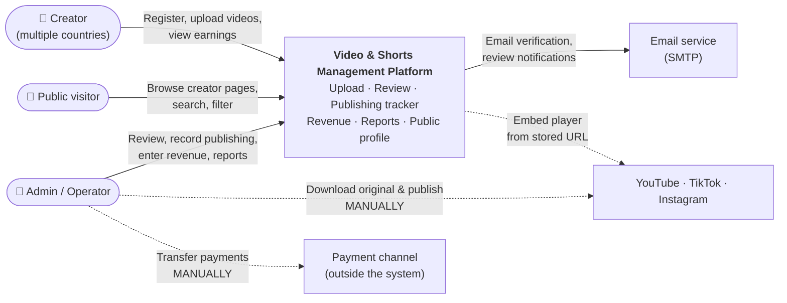
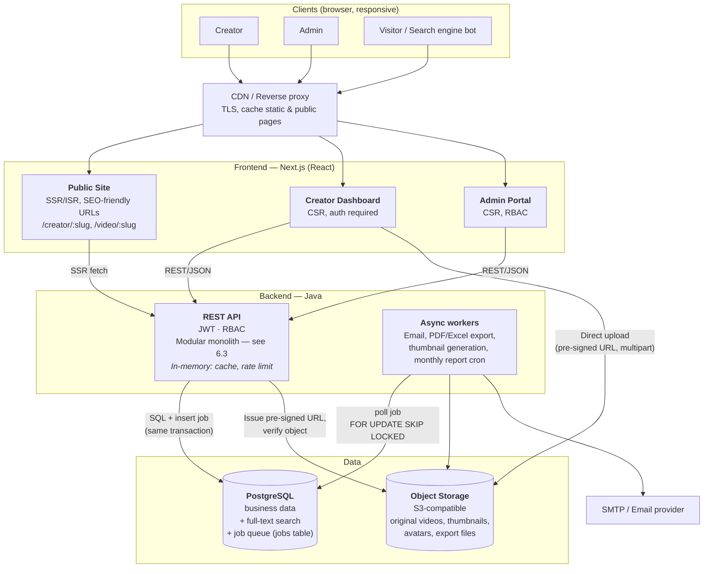
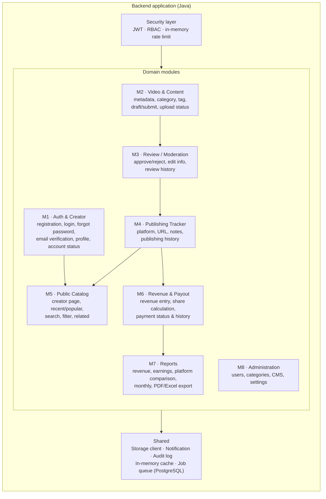
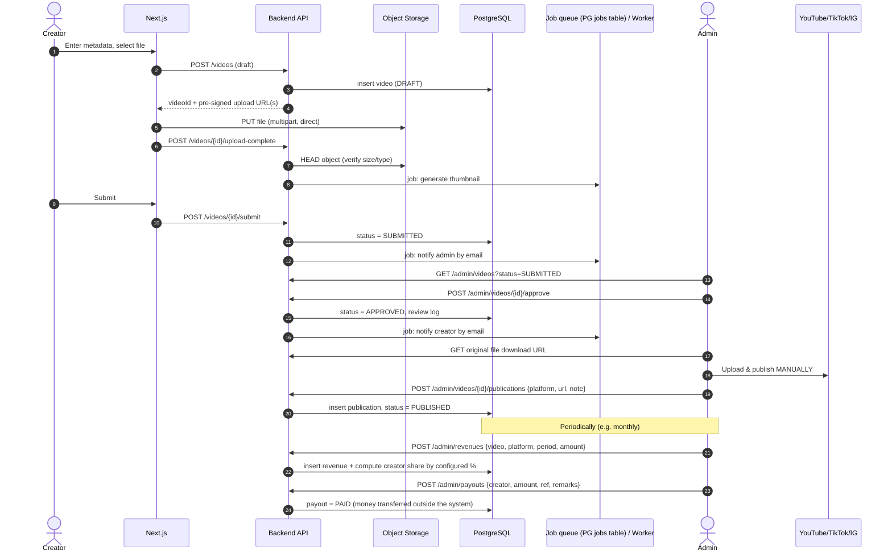
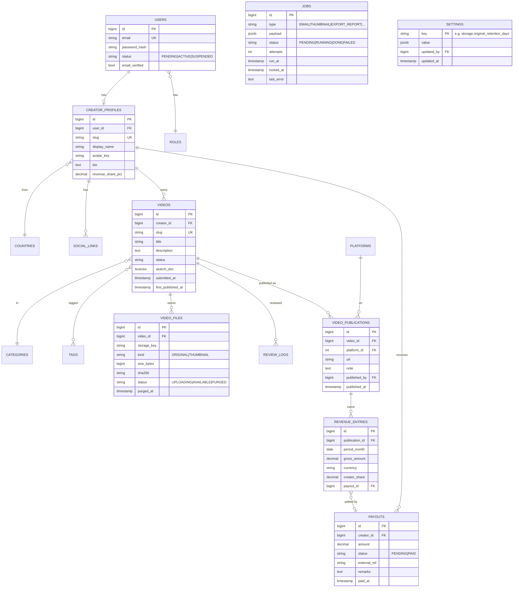
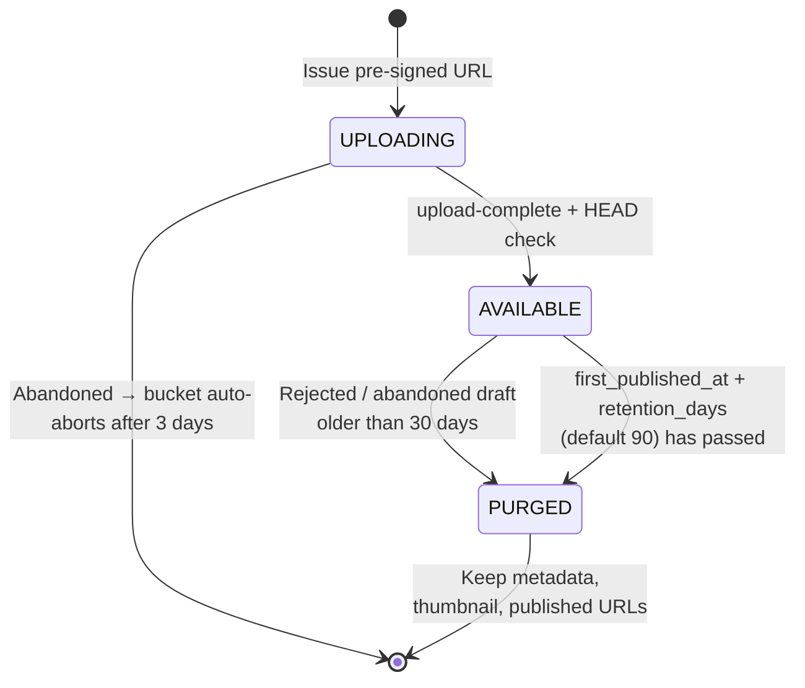
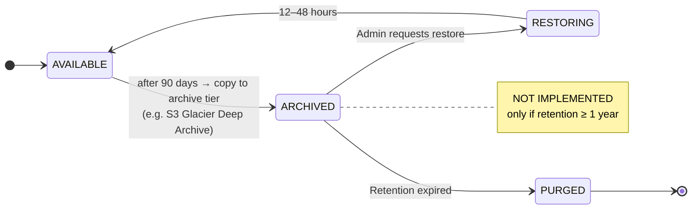

## 6. Technical Architecture & Technology Stack

This section describes the technical architecture of the Video & Shorts Management Platform: system components, main business flow, data model, capacity, storage cost optimization strategy, and design decisions.

---

### 6.1. Context diagram

Who uses the system, and what the system interacts with.

Dashed lines = manual operations or reference only; no API integration.

---

### 6.2. Container diagram

---

### 6.3. Backend modules

One-to-one mapping with the modules in the estimation document.

---

### 6.4. Main flow: upload → review → publish → revenue

---

### 6.5. Core data model

`JOBS` is standalone (no FKs) — it is the worker queue, indexed on `(status, run_at)`.

`revenue_share_pct` is stored on the profile and **snapshotted** into `creator_share` when revenue is entered, so changing the percentage later does not alter historical figures.

---

### 6.6. Capacity

The backend mainly handles CRUD and page rendering.

| Component | Estimated capacity | Notes |
|---|---|---|
| Public site (Next.js SSR/ISR + CDN) | Millions of pageviews/day | CDN serves most requests; origin receives only a small share |
| Java API ×2 | ~1,000–2,000 req/s | Simple queries, with in-memory cache |
| PostgreSQL | Several thousand simple queries/s | Requires proper indexing |
| Job queue on PG | Hundreds of jobs/s | Actual demand is only a few jobs per video — ample headroom |
| Users | Thousands to tens of thousands of creators; hundreds concurrently online on dashboards | |
| Videos | Up to ~1 million videos, including full-text search | |
| Revenue | 100k videos × 3 platforms × 12 months ≈ 3.6 million rows/year | Fine with indexes |
| Storage | Stable at ~300 GB thanks to the 90-day retention policy (6.7) | Assumes 100 GB of new original files/month |

---

### 6.7. File storage cost optimization

Because the public site **embeds** videos from YouTube / TikTok / IG, object storage is only an archive of original files: a file is actually used only between upload and the moment the admin downloads it for publishing. The policy below keeps storage volume nearly flat over time.

> **Decision:** keep original files for **90 days** after first publication, then delete (configurable); use **a single storage tier**; **no cold storage**. Rationale and fallback: see 6.7.4.

#### 6.7.1. Retention policy

| File type | Retention | Deletion mechanism |
|---|---|---|
| Original video (published) | **90 days** from first publication (`first_published_at`), **configurable** | Application cleanup job |
| Original video (rejected / abandoned draft) | 30 days from last update, configurable | Application cleanup job |
| Incomplete uploads (unfinished multipart) | 3 days | Bucket lifecycle rule |
| PDF/Excel export files | 7 days | Lifecycle rule on prefix `exports/` |
| Thumbnails, avatars | Kept permanently (small, needed by the public site) | — |

After the original file is deleted, the video **still displays normally** on the public site (embedded from the published URL); only the original file can no longer be downloaded.

#### 6.7.2. Original file lifecycle

There is no cold-storage state because the 90-day retention is fixed. If the policy later changes to ≥ 1 year, the lifecycle extends as follows (only new states are added; the design does not change):

#### 6.7.3. Additional measures

- **Provider**: not yet chosen — TODO I6 in 6.8.3 (S3-compatible, **low egress fees** since the admin downloads original files for publishing, lifecycle rule support). The backend uses the S3-compatible API, so switching providers requires no code changes.
- **Bucket lifecycle rules** are used to: abort incomplete multipart uploads after 3 days, delete the `exports/` prefix after 7 days. Deleting original files by publication date is still handled by the application cleanup job.
- **Upload limits**: file size, duration, resolution, format (configurable in Settings); the backend re-verifies via HEAD after upload.
- **Per-creator quota**: total size of original files currently `AVAILABLE`.
- **Deduplication**: store `sha256` to detect a creator re-uploading the same file.
- **Images**: thumbnails / avatars stored as WebP in a few fixed sizes, served via CDN with long cache lifetimes.
- **Do not** re-encode original videos (H.265/AV1): costly in CPU and degrades quality before the platforms compress it again.

#### 6.7.4. Cold storage

**Not used** with the 90-day retention policy:
- Deleting after 90 days already removes ~90% of the volume; a cold tier would save only **~$1–3/month** on the remaining ~300 GB.
- Cold tiers have minimum storage durations and retrieval fees, while files would sit there for only ~60 days.
- Development effort (~1–2 days) far exceeds the savings.

**If the retention period changes:**

| Retention | Approach |
|---|---|
| ≤ 6 months | Keep a single storage tier; only change the configuration |
| 6–12 months | Single tier; optionally transition to an Infrequent Access tier after 30 days |
| ≥ 1 year / forever | Add a low-cost archive tier for files older than 90 days (extended diagram in 6.7.2) — ~$5–10/month instead of ~$15–90/month |

---

### 6.8. Design decisions

Design decisions and technology choices. **TODO** rows are not yet decided: the "Decision" column lists candidates and the "Rationale" column lists selection criteria — replace them with the choice and rationale once decided. *Candidate pricing must be re-verified at selection time.*

#### 6.8.1. Application architecture

| # | Decision | Rationale |
|---|---|---|
| D1 | **Modular monolith** (single Java backend, modules M1–M8) | 14–16 week project, single team; avoids microservices operational overhead. Modules are cleanly separated into packages so they can be split into services later if needed |
| D2 | **Next.js SSR/ISR** for the public site; CSR for dashboards | SEO-friendly URLs for creator / video pages |
| D3 | **Direct upload to object storage** via pre-signed URL (multipart) | Large video files bypass the backend; the backend only performs a HEAD check after upload |
| D4 | **Public site embeds videos** from published URLs — no streaming, no transcoding | Viewing bandwidth is borne by YouTube / TikTok / IG |
| D5 | **Search with PostgreSQL full-text** (`tsvector`) | Sufficient for ~1 million videos, no extra component |
| D6 | **No Redis** | Saves infrastructure cost; PostgreSQL can handle the job queue at this scale, and cache and rate limiting stay in memory (D7–D9) |
| D7 | **In-memory cache** per API instance, for read-heavy, rarely changing data: categories, settings, public creator pages | Read-heavy, rarely changing data; inconsistency up to TTL expiry is acceptable |
| D8 | **In-memory rate limiting**, not yet persisted in PostgreSQL — applied to login, forgot password, registration, public API | Simple; effective limit = limit × number of instances is acceptable |
| D9 | **Job queue on PostgreSQL** (`jobs` table, written in the same transaction, `FOR UPDATE SKIP LOCKED`, retry/backoff) | Low volume (~10k jobs/month); writing jobs in the same transaction means no lost jobs and no jobs running for rolled-back data — a separate queue would still need an outbox table in PostgreSQL to be safe. **No operational cost of a separate queue** (infrastructure, monitoring, HA) |
| D10 | **Manual publishing**; publishing status stored per platform | Per the quoted scope |

#### 6.8.2. File storage

Details, diagrams and cost analysis: 6.7.

| # | Decision | Rationale |
|---|---|---|
| S1 | Object storage via **S3-compatible API** | Switching providers requires no code changes |
| S2 | **Two buckets**: `originals` (private) and `media` (public-read via CDN) | Original files are never public; images are cached at the CDN |
| S3 | **Keep original files for 90 days** from first publication, then delete; the number of days is **configurable** in Settings | Original files are only needed until the admin publishes; volume stays at ~300 GB instead of growing indefinitely (~3.6 TB after 3 years) |
| S4 | Files of **rejected / abandoned draft** videos: deleted after 30 days (configurable) | Do not keep files that will never be used |
| S5 | **Incomplete uploads** (unfinished multipart): aborted after 3 days via bucket lifecycle rule | Incomplete parts are still billed even though they do not appear in file listings |
| S6 | **PDF/Excel export files**: deleted after 7 days via lifecycle rule on prefix `exports/` | Temporary files |
| S7 | Original files deleted by an **application cleanup job** (daily, batched, idempotent; delete the object first, then update the DB) | Deletion deadline is based on publication date + dynamic configuration → bucket lifecycle rules (based on object creation date) cannot do this |
| S8 | Deletion deadline is **computed dynamically** (= first publication date + current setting); the Settings screen **warns how many files / how much data will be deleted** before saving a reduced value | Configuration changes apply to all videos; prevents accidental mass deletion |
| S9 | After deleting the original file, **keep metadata, thumbnail, published URLs**; the video remains visible on the public site | The public site only needs the embed URL |
| S10 | **Single storage tier, no cold storage** | With 90-day retention, cold storage saves only ~$1–3/month, has minimum storage durations, and costs ~1–2 days of effort |
| S11 | File status stored as a **string** (`UPLOADING` / `AVAILABLE` / `PURGED`) | `ARCHIVED`, `RESTORING` can be added later without schema changes |
| S12 | Upload limits: size, duration, resolution, format; per-creator storage quota; store `sha256` to prevent duplicate uploads | Controls cost at the input |
| S13 | Thumbnails / avatars stored as **WebP** in a few fixed sizes | Reduces storage and CDN bandwidth |
| S14 | **Do not** re-encode original videos | Costly in CPU, degrades quality before the platforms compress again |

#### 6.8.3. Infrastructure & CDN

| # | Decision | Rationale |
|---|---|---|
| I1 | **Use a CDN** in front of the whole web app (cache public pages, static assets, images; bypass API / dashboards) | Speed for viewers in many countries, SEO, TLS / WAF / DDoS |
| I2 | **Origin accepts traffic only from the CDN** | Nobody can bypass the WAF |
| I3 | **Uploads do not go through the CDN proxy** | Avoids the CDN's request size limits |
| I4 | **Purge cache via a job** (`PURGE_CDN`) when public data changes | Public pages are cached briefly yet still update immediately when needed |
| I5 | **Container**-based compute: 2 Next.js + 2 API + 1 worker | Sufficient for the capacity in 6.6, with redundancy |
| I6 | Object storage: **TODO** — candidates: Cloudflare R2 (free egress), Backblaze B2 (lowest storage price), AWS S3, GCS, Wasabi | Criteria: S3-compatible; **low egress fees** (admin downloads original files for publishing); lifecycle rules (abort multipart, delete by prefix); custom domain behind CDN |
| I7 | CDN: **TODO** — candidates: Cloudflare (Free / Pro plan), AWS CloudFront, Bunny CDN | Criteria: no or low bandwidth fees; basic WAF + DDoS; purge-by-URL API; request size limits (uploads bypass the CDN) |
| I8 | Hosting / compute: **TODO** — candidates: AWS, GCP, Azure, DigitalOcean, Hetzner, … | Criteria: runs containers; managed PostgreSQL with backups; secrets manager; same region as storage |
| I9 | Email: **TODO** — candidates: Amazon SES, SendGrid, Mailgun, Postmark | Criteria: SMTP / API, good inbox deliverability, volume-based pricing |

#### 6.8.4. Backend technology

| # | Decision | Rationale |
|---|---|---|
| T1 | Backend framework: **Spring Boot** | Largest Java ecosystem, Spring Security ready for JWT / RBAC, easy to hire for |
| T2 | In-memory cache: **Caffeine** | TTL, size limits, built-in Spring Cache integration |
| T3 | In-memory rate limiting: **Bucket4j** | Token bucket, per-IP / per-user limits, runs in memory with no extra infrastructure |
| T4 | Job queue on PostgreSQL: **JobRunr** | Transactional enqueue, retry, scheduled (cron) jobs, monitoring dashboard; no need to build it ourselves |
