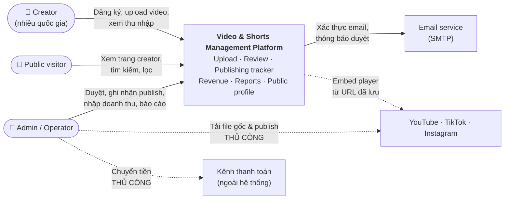
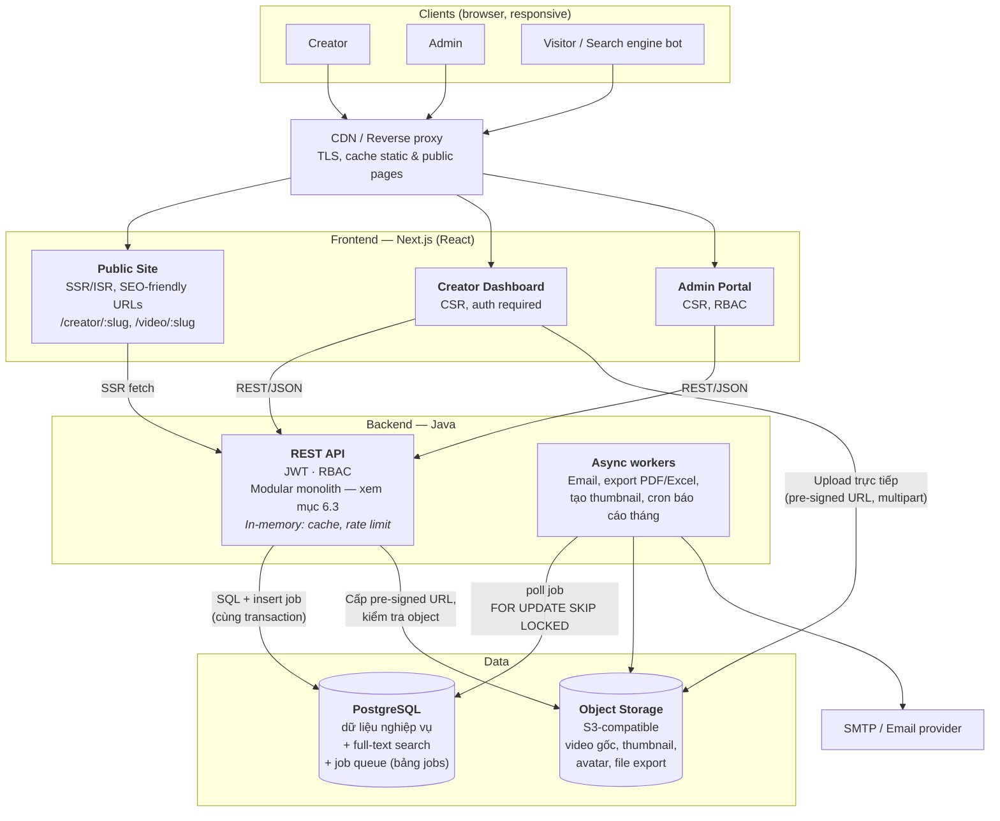
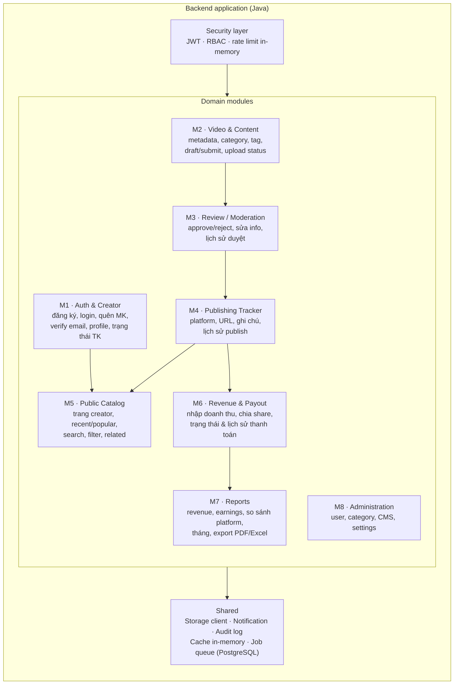
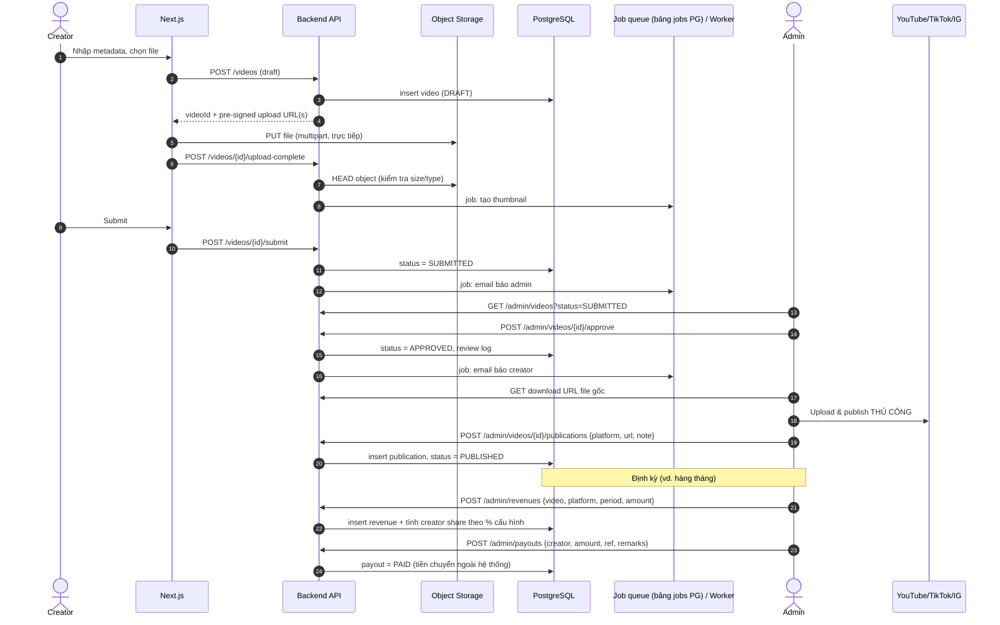
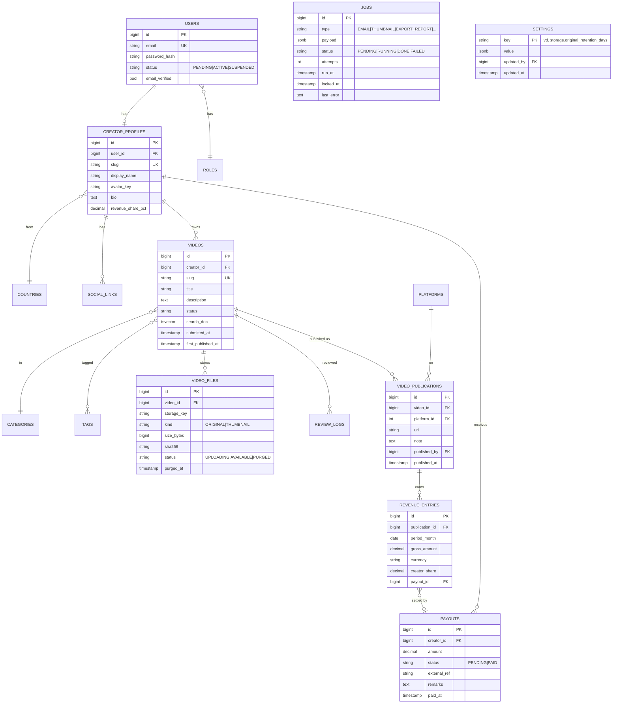
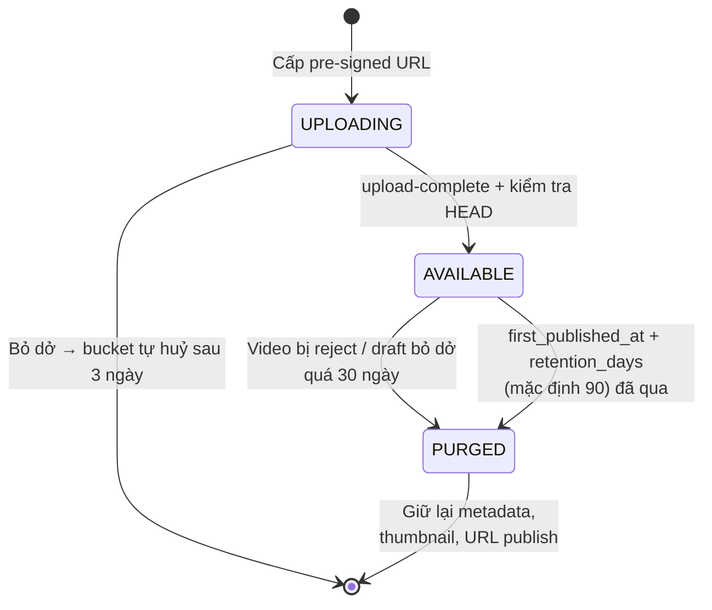
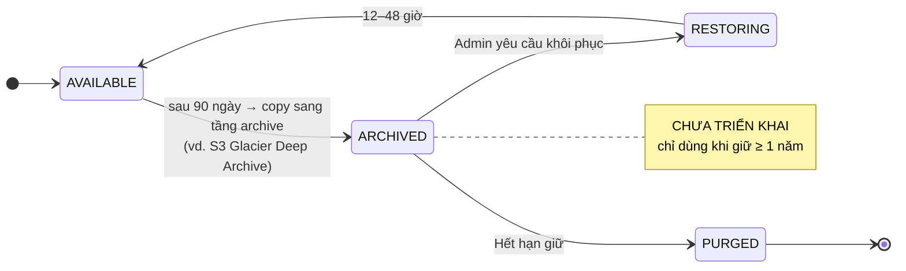

## 6. Technical Architecture & Technology Stack

Phần này mô tả kiến trúc kỹ thuật của Video & Shorts Management Platform: các thành phần hệ thống, luồng nghiệp vụ chính, mô hình dữ liệu, năng lực đáp ứng, chiến lược tối ưu chi phí lưu trữ và các quyết định thiết kế.

---

### 6.1. Context diagram

Ai dùng hệ thống, và hệ thống chạm tới đâu.

Nét đứt = thao tác thủ công hoặc chỉ tham chiếu, không có API integration.

---

### 6.2. Container diagram

---

### 6.3. Backend modules

Ánh xạ 1-1 với các module trong tài liệu estimation.

---

### 6.4. Luồng chính: upload → review → publish → doanh thu

---

### 6.5. Data model cốt lõi

`JOBS` đứng độc lập (không FK) — là hàng đợi cho worker, index trên `(status, run_at)`.

`revenue_share_pct` lưu trên profile và được **chụp lại** vào `creator_share` khi nhập doanh thu, để đổi % sau này không làm sai số liệu cũ.

---

### 6.6. Năng lực đáp ứng

Backend chủ yếu xử lý CRUD và render trang.

| Thành phần | Mức đáp ứng ước tính | Ghi chú |
|---|---|---|
| Trang public (Next.js SSR/ISR + CDN) | Hàng triệu pageview/ngày | CDN trả phần lớn request, origin chỉ nhận một phần nhỏ |
| Java API ×2 | ~1.000–2.000 req/s | Truy vấn đơn giản, có cache in-memory |
| PostgreSQL | Vài nghìn truy vấn đơn giản/s | Cần index đúng |
| Job queue trên PG | Hàng trăm job/s | Nhu cầu thực tế chỉ vài job mỗi video — rất dư |
| Người dùng | Hàng nghìn – vài chục nghìn creator; vài trăm người online cùng lúc trên dashboard | |
| Video | Tới ~1 triệu video vẫn ổn, kể cả full-text search | |
| Doanh thu | 100k video × 3 platform × 12 tháng ≈ 3,6 triệu dòng/năm | Ổn nếu có index |
| Storage | Ổn định ~300 GB nhờ chính sách giữ 90 ngày (mục 6.7) | Giả định 100 GB file gốc mới/tháng |

---

### 6.7. Tối ưu chi phí file storage

Vì trang public **embed** video từ YouTube / TikTok / IG, object storage chỉ là kho file gốc: file chỉ thực sự được dùng từ lúc upload tới lúc admin tải về để publish. Chính sách dưới đây giữ dung lượng gần như không tăng theo thời gian.

> **Quyết định:** giữ file gốc **90 ngày** sau lần publish đầu tiên rồi xoá (cấu hình được), dùng **một lớp storage**, **không dùng lưu trữ lạnh**. Lý do và phương án dự phòng: xem 6.7.4.

#### 6.7.1. Chính sách lưu giữ

| Loại file | Giữ bao lâu | Cơ chế xoá |
|---|---|---|
| Video gốc đã publish | **90 ngày** kể từ lần publish đầu tiên (`first_published_at`), **cấu hình được** | Job dọn dẹp của ứng dụng |
| Video gốc của video bị reject / draft bỏ dở | 30 ngày kể từ lần cập nhật cuối, cấu hình được | Job dọn dẹp của ứng dụng |
| Upload dở dang (multipart chưa hoàn tất) | 3 ngày | Lifecycle rule của bucket |
| File export PDF/Excel | 7 ngày | Lifecycle rule theo prefix `exports/` |
| Thumbnail, avatar | Giữ vĩnh viễn (nhỏ, cần cho trang public) | — |

Sau khi xoá file gốc, video **vẫn hiển thị bình thường** trên trang public (embed từ URL đã publish), chỉ không tải lại được file gốc.

#### 6.7.2. Vòng đời file gốc

Không có trạng thái lưu trữ lạnh vì đã chốt giữ 90 ngày. Nếu sau này đổi chính sách sang ≥ 1 năm, vòng đời sẽ mở rộng như sau (chỉ là thêm trạng thái, không phải sửa thiết kế):

#### 6.7.3. Các biện pháp bổ sung

- **Nhà cung cấp**: chưa chọn — TODO I6 ở mục 6.8.3 (S3-compatible, **phí egress thấp** vì admin tải file gốc về để publish, có lifecycle rule). Backend dùng S3-compatible API nên đổi nhà cung cấp không phải sửa code.
- **Lifecycle rule của bucket** dùng cho: huỷ multipart upload dở dang sau 3 ngày, xoá prefix `exports/` sau 7 ngày. Việc xoá file gốc theo ngày publish vẫn do job dọn dẹp của ứng dụng.
- **Giới hạn khi upload**: dung lượng, thời lượng, độ phân giải, định dạng (cấu hình trong Settings); backend kiểm tra lại bằng HEAD sau khi upload.
- **Quota theo creator**: tổng dung lượng file gốc đang `AVAILABLE`.
- **Chống trùng**: lưu `sha256` để phát hiện creator upload lại cùng một file.
- **Ảnh**: thumbnail / avatar lưu WebP, vài kích thước cố định, phục vụ qua CDN với cache dài.
- **Không** nén lại video gốc (H.265/AV1): tốn CPU, giảm chất lượng trước khi nền tảng nén lần nữa.

#### 6.7.4. Lưu trữ lạnh

**Không dùng** với chính sách giữ 90 ngày:
- Xoá sau 90 ngày đã cắt ~90% dung lượng; lớp lạnh chỉ tiết kiệm thêm **~$1–3/tháng** trên ~300 GB còn lại.
- Lớp lạnh có thời gian lưu tối thiểu và phí lấy ra, trong khi file chỉ nằm đó ~60 ngày.
- Công phát triển (~1–2 ngày) lớn hơn nhiều so với số tiền tiết kiệm.

**Khi đổi thời gian giữ:**

| Thời gian giữ | Hướng xử lý |
|---|---|
| ≤ 6 tháng | Giữ một lớp storage, chỉ đổi cấu hình |
| 6–12 tháng | Một lớp; có thể chuyển sang lớp Infrequent Access sau 30 ngày |
| ≥ 1 năm / vĩnh viễn | Thêm tầng archive giá rẻ cho file sau 90 ngày (diagram mở rộng ở 6.7.2) — chi phí ~$5–10/tháng thay vì ~$15–90/tháng |

---

### 6.8. Quyết định thiết kế

Các quyết định thiết kế và lựa chọn công nghệ. Dòng **TODO** là hạng mục chưa chốt: cột "Quyết định" ghi ứng viên, cột "Lý do" ghi tiêu chí chọn — khi chốt thì thay bằng lựa chọn và lý do. *Giá của các ứng viên cần kiểm tra lại khi chọn.*

#### 6.8.1. Kiến trúc ứng dụng

| # | Quyết định | Lý do |
|---|---|---|
| D1 | **Modular monolith** (1 backend Java, chia module M1–M8) | Dự án 14–16 tuần, 1 team; tránh chi phí vận hành microservices. Các module tách package rõ để sau này tách service nếu cần |
| D2 | **Next.js SSR/ISR** cho trang public; CSR cho dashboard | SEO-friendly URLs cho trang creator / video |
| D3 | **Upload trực tiếp lên object storage** bằng pre-signed URL (multipart) | File video lớn không đi qua backend; backend chỉ kiểm tra HEAD sau khi upload |
| D4 | **Trang public embed video** từ URL đã publish, không stream, không transcode | Băng thông xem do YouTube / TikTok / IG chịu |
| D5 | **Search bằng PostgreSQL full-text** (`tsvector`) | Đủ cho ~1 triệu video, không thêm thành phần |
| D6 | **Không dùng Redis** | Tiết kiệm chi phí hạ tầng; PostgreSQL đủ sức gánh job queue ở quy mô này, cache và rate limit giữ trong bộ nhớ (D7–D9) |
| D7 | **Cache in-memory** trong từng instance API, cho dữ liệu đọc nhiều, ít đổi: category, settings, trang creator public | Dữ liệu đọc nhiều, ít đổi; chấp nhận lệch tới hết TTL |
| D8 | **Rate limit in-memory**, chưa lưu vào PostgreSQL — áp dụng cho login, quên mật khẩu, đăng ký, API public | Đơn giản; limit thực tế = limit × số instance là chấp nhận được |
| D9 | **Job queue trên PostgreSQL** (bảng `jobs`, ghi cùng transaction, `FOR UPDATE SKIP LOCKED`, retry/backoff) | Khối lượng nhỏ (~10k job/tháng); ghi job cùng transaction nên không mất job hay chạy job cho dữ liệu đã rollback — queue riêng muốn an toàn vẫn phải thêm bảng outbox trong PostgreSQL. **Không tốn chi phí vận hành queue riêng** (hạ tầng, giám sát, HA) |
| D10 | **Publish thủ công**; trạng thái publish lưu theo từng platform | Theo phạm vi báo giá |

#### 6.8.2. Lưu trữ file

Chi tiết, diagram và phân tích chi phí: mục 6.7.

| # | Quyết định | Lý do |
|---|---|---|
| S1 | Object storage dùng **API S3-compatible** | Đổi nhà cung cấp không phải sửa code |
| S2 | **Tách 2 bucket**: `originals` (private) và `media` (public-read qua CDN) | File gốc không bao giờ public; ảnh được cache ở CDN |
| S3 | **Giữ file gốc 90 ngày** kể từ lần publish đầu tiên rồi xoá; số ngày **cấu hình được** trong Settings | File gốc chỉ cần tới lúc admin publish; dung lượng ổn định ~300 GB thay vì tăng mãi (~3,6 TB sau 3 năm) |
| S4 | File của video **bị reject / draft bỏ dở**: xoá sau 30 ngày (cấu hình được) | Không giữ file không bao giờ được dùng |
| S5 | **Upload dở dang** (multipart chưa hoàn tất): huỷ sau 3 ngày bằng lifecycle rule của bucket | Phần upload dở vẫn bị tính tiền dù không thấy trong danh sách file |
| S6 | **File export PDF/Excel**: xoá sau 7 ngày bằng lifecycle rule theo prefix `exports/` | File tạm |
| S7 | Xoá file gốc bằng **job dọn dẹp của ứng dụng** (chạy hằng ngày, theo batch, idempotent; xoá object trước rồi mới cập nhật DB) | Hạn xoá tính theo ngày publish + cấu hình động → lifecycle rule của bucket (tính theo ngày tạo object) không làm được |
| S8 | Hạn xoá **tính động** (= ngày publish đầu tiên + cấu hình hiện tại); màn hình Settings **cảnh báo số file / dung lượng sẽ bị xoá** trước khi lưu khi giảm số ngày | Đổi cấu hình áp dụng cho mọi video, tránh xoá nhầm hàng loạt |
| S9 | Sau khi xoá file gốc, **giữ metadata, thumbnail, URL publish**; video vẫn hiển thị trên trang public | Trang public chỉ cần URL embed |
| S10 | **Một lớp storage, không dùng lưu trữ lạnh** | Với 90 ngày, lưu trữ lạnh chỉ tiết kiệm ~$1–3/tháng, vướng thời gian lưu tối thiểu, tốn ~1–2 ngày công |
| S11 | Trạng thái file lưu dạng **string** (`UPLOADING` / `AVAILABLE` / `PURGED`) | Thêm `ARCHIVED`, `RESTORING` sau này không phải sửa schema |
| S12 | Giới hạn khi upload: dung lượng, thời lượng, độ phân giải, định dạng; quota dung lượng theo creator; lưu `sha256` để chống upload trùng | Kiểm soát chi phí từ đầu vào |
| S13 | Thumbnail / avatar lưu **WebP**, vài kích thước cố định | Giảm dung lượng và băng thông CDN |
| S14 | **Không** nén lại video gốc | Tốn CPU, giảm chất lượng trước khi nền tảng nén lần nữa |

#### 6.8.3. Hạ tầng & CDN

| # | Quyết định | Lý do |
|---|---|---|
| I1 | **Có dùng CDN** trước toàn bộ web (cache trang public, static, ảnh; bypass API / dashboard) | Tốc độ cho người xem nhiều quốc gia, SEO, TLS / WAF / DDoS |
| I2 | **Origin chỉ nhận traffic từ CDN** | Không ai bỏ qua được WAF |
| I3 | **Upload không đi qua proxy CDN** | Tránh giới hạn kích thước request của CDN |
| I4 | **Purge cache bằng job** (`PURGE_CDN`) khi dữ liệu public đổi | Trang public cache ngắn nhưng vẫn cập nhật ngay khi cần |
| I5 | Compute dạng **container**, 2 Next.js + 2 API + 1 worker | Đủ cho quy mô mục 6.6, có dự phòng |
| I6 | Object storage: **TODO** — ứng viên: Cloudflare R2 (miễn phí egress), Backblaze B2 (giá lưu trữ thấp nhất), AWS S3, GCS, Wasabi | Tiêu chí: S3-compatible; **phí egress thấp** (admin tải file gốc về để publish); có lifecycle rule (huỷ multipart, xoá theo prefix); custom domain sau CDN |
| I7 | CDN: **TODO** — ứng viên: Cloudflare (gói Free / Pro), AWS CloudFront, Bunny CDN | Tiêu chí: không tính / tính thấp phí băng thông; WAF + DDoS cơ bản; API purge theo URL; giới hạn kích thước request (upload không đi qua) |
| I8 | Hosting / compute: **TODO** — ứng viên: AWS, GCP, Azure, DigitalOcean, Hetzner, … | Tiêu chí: chạy container; managed PostgreSQL có backup; secrets manager; cùng region với storage |
| I9 | Email: **TODO** — ứng viên: Amazon SES, SendGrid, Mailgun, Postmark | Tiêu chí: SMTP / API, tỉ lệ vào inbox tốt, giá theo lượng |

#### 6.8.4. Công nghệ backend

| # | Quyết định | Lý do |
|---|---|---|
| T1 | Backend framework: **Spring Boot** | Hệ sinh thái lớn nhất cho Java, Spring Security sẵn cho JWT / RBAC, dễ tuyển người |
| T2 | Cache in-memory: **Caffeine** | TTL, giới hạn kích thước, tích hợp sẵn với Spring Cache |
| T3 | Rate limit in-memory: **Bucket4j** | Token bucket, giới hạn theo IP / user, chạy in-memory không cần thêm hạ tầng |
| T4 | Job queue trên PostgreSQL: **JobRunr** | Enqueue cùng transaction, retry, job định kỳ (cron), có dashboard theo dõi; không phải tự viết |
